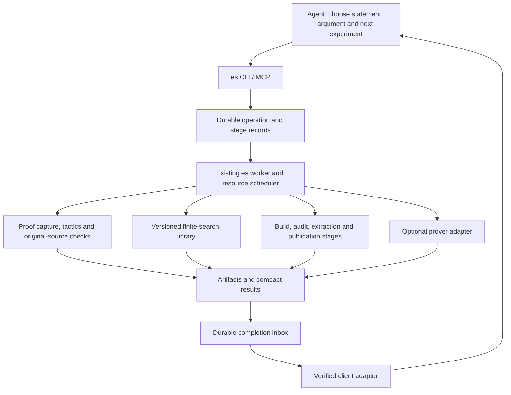

# Automation plan for the `es` research harness

**Status:** implementation approved on 12 September 2026. The current command surface,
test evidence, operating instructions and gates are in
[automation-implementation.md](automation-implementation.md). This design remains the
roadmap; a proposed capability below is not automatically a verified capability.

**Objective:** reduce frontier-model usage per checked research result by moving repeated
execution, bookkeeping, retrieval and proof checking into deterministic `es` operations.
Keep mathematical choices and the repair of genuinely difficult arguments with the agent.
Measure the whole goal window, including unsuccessful work and automation maintenance.

## 1. Evidence and priorities

The [two-window profile](../runs/token-profile-20260912/REPORT.md) reconciles usage with
the original session records. September 10's research goal window used 1,837,176 output
tokens, including 863,767 reasoning-output tokens, across 1,874 responses. It also used
5,892,827 uncached input tokens and 268,670,464 cached input tokens.

| Observable activity associated with responses | Output share |
|---|---:|
| Lean edits, proof generators and checks | 27.3% |
| Retrieval and diagnostics | 18.2% |
| Monitoring and time accounting | 12.4% |
| Finite searches and probes | 10.5% |
| Context compaction | 9.6% |
| Research administration | 9.3% |
| Other tooling/document edits | 7.1% |
| Handoffs and reports | 5.4% |

These are heuristic associations of complete responses with tool actions, not causal
allocations of reasoning or achievable savings. Do not sum overlapping script associations,
add reasoning to output again, or translate raw tokens into a weekly allowance percentage.

Concrete repetition in that run: 41 probe scripts; 111 prepare/regenerate/strengthen
scripts; identical search functions in four to six files; 35 full-index refresh jobs and
71 publication jobs. Seventeen compaction-associated responses used 176,462 output tokens.
The inspected probes predominantly implement finite enumeration, dynamic programming and
small optimization searches. A new general SAT service is not the first priority.

The prover experiments support a separate conclusion: Aristotle accepted six historical
proofs without frontier mathematical repairs, but demonstrated no token savings in the
experimental workflow. The two tested local neural models demonstrated no independent
win on their scored residual goals. The subsequent open single-run Aristotle attempt was
still running when this plan was prepared; it exceeded its 6,000-output-token target.
An expensive remote attempt plus a live frontier polling loop is not the desired design.

**First delivery:** reliable completion, compact results, and an automatic path from a
prepared proof body to a reviewable, verified change. Next, consolidate finite-search
primitives and retrieval. Add specialized prover routing after this path is economical.

## 2. Existing implementation and integration points

The implementation, rather than older prose or run-specific wrappers, defines current
behavior. In particular, the worker already starts several jobs when their caps fit;
some earlier documentation still describes it as serial.

| Existing component | Reuse and required extension |
|---|---|
| `es/spec.py`, `cli.py`, `mcp_server.py` | Keep one command registry for CLI/MCP. Add structured operation commands; do not assume `long_running=True` automatically makes an MCP handler asynchronous. |
| `es/jobs.py`, `commands/jobs.py` | Keep jobs, WSL worker and guarded execution. Add atomic resource reservation, execution leases, cancellation acknowledgement and completion events. |
| `es/store.py` | Add versioned workflow, stage, artifact, delivery and usage records alongside jobs/events. SQLite remains operational state, not theorem truth. |
| `commands/node.py`, `check.py` | Reuse registration, statement locking, targeted extraction and checking. Turn their results into explicit stage outcomes. |
| `commands/extract.py`, `nodes.py`, `status.py` | Keep compiled-environment authority; distinguish verified candidate evidence from a current authoritative frontier. |
| `commands/search.py` | Extend existing project FTS/type-hash search with compact context bundles and provenance-aware caches. |
| `commands/falsify.py` | Retain the registered falsifier contract. Reusable exploratory probes get a separate interface and explicit semantics. |
| `commands/audit.py`, `layers.py`, `close.py`, git helpers | Reuse validation and promotion rules. `es close` moves a theorem into core; it is not a synonym for successful proof checking or publication. |
| `commands/note.py`, `log.py`, claims | Generate routine reports from recorded facts and keep judgments/plan changes explicit. |

Promote useful behavior from `runs/2026-09-10-active-lean-research/` rather than copying its
scripts unchanged. Relevant examples are `submit.py`, `register_node.py`, `apply_body.py`,
`proof_errors.py`, `publish_node.py`, `refresh_after_node.py`, `publish_node_refresh.py`,
`ledger.py`, `set_stage.py` and the diagnostic common module. They contain fixed run paths,
agent IDs and assumptions that must become validated inputs.

Two prerequisites surfaced in code review:

* `job cancel` currently catches signaling errors and can still record `killed`.
  A sandbox cannot reliably signal a worker outside it. Record a cancellation request and
  have the owning worker acknowledge termination before reporting that it stopped.
* The primary checkout config sets full extraction to 36G while the shared job budget is
  30G. The historical research worktree used different caps and temporarily edited its
  config during refresh. Validate the effective worktree configuration and use stage-specific
  resource settings. Do not automatically raise the shared budget or edit tracked config
  while a workflow runs. A full refresh that cannot fit is an explicit resource blockage.

## 3. Ownership and architecture



`es` remains a local Python package with SQLite and a WSL worker. Use in-process library
calls for short deterministic operations and existing guarded jobs for substantial work.
Separate local compute stages from remote-service waiting so a remote proof does not reserve
a 6G compute slot for hours. Remote submission/poll/retrieval are durable controller stages
owned by the recorded worker; process work still has caps and logs.

Project mathematics belongs under a proposed `harness/research/` package with a configured
entry point. Generic orchestration lives under `tools/es/es/`. No theorem names or fixed
project paths enter the generic package. MCP and an optional future local HTTP adapter
expose the same handlers; a network microservice is unnecessary for the first version.

The first workflow is a small fixed sequence of stages, not a general theorem-DAG planner.
The agent continues to choose nodes through `es ready`, log method changes, and create or
restate statements through their existing commands. Automatic retries must not invent new
statements, silently change hypotheses, promote a theorem into core, or claim a proof from
a service status or finite search.

## 4. Durable operations, resources and recovery

Introduce an **operation** spanning several existing jobs. For example, one `node_finish`
operation covers candidate validation, required audits, extraction and authorized publication.
An operation is not a Codex research goal and does not implicitly create one.

Minimal additive schema, with foreign keys and versioned JSON payloads:

| Record | Essential fields |
|---|---|
| `operations` | ID, kind, agent/session, optional research-window ID/node, worktree, branch/base commit, input manifest/hash, policy snapshot, status, timestamps |
| `operation_stages` | Operation/name/attempt, state, input hash, job ID, resource class, lease owner/expiry, output artifact IDs, structured failure |
| `artifacts` | Content hash, relative path, media/schema type, size, producer operation/stage, source identity |
| `deliveries` | Event ID, operation, target client/session, pending/sent/acknowledged state, attempts, next retry, acknowledgement |
| `usage_records` | Provider/session/response identity, time, input/cached-input/output/reasoning-output, operation/stage association and confidence, ingestion source |
| `research_windows` | Explicit begin/end or imported goal boundaries, objective reference, budget policy, measured coverage; no inferred mathematical progress |

Stage states: `pending → ready → running → succeeded`; alternatives are `waiting_external`,
`retryable_failure`, `needs_agent`, `blocked_resource`, `cancel_requested`, `cancelled`,
`failed` and `unknown_execution`. Keep job transport state separate from mathematical
outcomes such as `proof_accepted`, `proof_failed`, `scope_mismatch`, `witness_found` and
`no_witness_within_budget`.

Execution rules:

1. Atomically compare stage/job state and reserve RAM/CPU/GPU/worktree resources before
   changing `queued` to `starting`. A second worker must not launch the same stage.
   Use short SQLite transactions; never hold a transaction over a build/network call.
2. Use one memory reservation per compute stage, tied to the actual guarded process tree.
   Nested `es` calls must not reserve the same job twice or create an unaccounted inner
   cgroup with a larger cap. Include synchronous paths in the same accounting mechanism.
3. Preserve `max_parallel_builds`; use exclusive write/build leases per worktree and a
   GPU lease for inference. Independent probes may run concurrently within the shared cap.
   Add aging/reservation so a large refresh is not starved by a stream of small jobs.
4. Lease expiry means ownership is uncertain. Reconcile process identity, cgroup and
   heartbeat before retrying; never infer that an expired lease killed its process.
   Renew node claims only while their owning operation is active, with a bounded renewal
   policy; release with an honest outcome on terminal completion or explicit pause.
5. Write result artifacts atomically, then commit stage completion and its outbox event
   in one database transaction. Reconcile orphaned artifacts after a crash.
6. Use input/version hashes and an operation key to make repeated local submissions
   idempotent. Preserve each failed attempt and previously accepted proofs.
7. Git commits, pushes and remote prover submissions are external effects. Persist intent
   and receipts; if acknowledgement is lost, inspect the branch/remote/project before
   retrying. An ambiguous external effect is `needs_reconciliation`, never a blind retry.
8. Cancellation is acknowledged by the process owner. Local cancellation, remote-provider
   cancellation, observer timeout and client detachment are separate facts. A timeout must
   say whether remote work continues. No successful cancellation claim without evidence.

Proposed config groups: `[automation]`, `[automation.resources.<class>]`,
`[automation.delivery]`, `[automation.publication]`, `[automation.budgets]`,
`[provers.<backend>]`, and `[research.plugins]`. Defaults preserve existing execution and
publication policies. Feature flags enable each new path independently. Validate policies
at admission, freeze them for the operation, and show effective caps in `es doctor/status`.

## 5. Completion delivery is the first end-to-end gate

The current `es job wait --timeout 55` is useful for a bounded read. Repeatedly returning
to a frontier model to call it is the overhead this plan must remove. A durable checkpoint,
MCP progress update, desktop notification or outgoing agent-turn notification does not by
itself resume the correct model/client conversation.

Implement a worker outbox and a small **client adapter**:

* Register the project, session/thread identity, operation subscription, client capabilities
  and connection epoch. Store no credentials in event payloads.
* Deliver a compact terminal result or a genuine decision request. Ordinary heartbeats,
  percent-complete changes and logs update deterministic UI state without invoking a model.
* For an active client, verify its supported transport can resume the owning conversation
  with the operation result. If it is busy, queue/coalesce delivery without overlapping
  mathematical turns. Do not start another agent or switch models implicitly.
* For a disconnected client, retain a pending inbox entry. Drain it on reconnection or the
  next session start. Claim closed-client wake-up only if that exact host supports it and
  a test proves it; otherwise the documented guarantee is delivery on reconnection.
* Use at-least-once delivery, event IDs and durable consumer deduplication/acknowledgement.
  Do not promise impossible exactly-once delivery across a crash boundary.
* A user pause suppresses new model continuations; results remain available. Cancellation
  of compute requires the separate cancellation action.

The existing client probe found no live app-server control socket in the current Codex CLI.
Therefore the first increment includes a short capability test against the installed client,
not an assumption that adding an MCP tool creates a callback. If needed, implement a thin
launcher that owns a supported client connection, without adding another paid model API.
Support Claude Code through its verified adapter as well. If neither adapter can provide
delivery, ship a durable inbox and explicitly mark unattended reporting unsupported; do not
declare that the principal monitoring-saving gate passed.

Acceptance: pause an operation behind a fake delayed backend; make zero model requests
during a 30-minute wait; deliver one result-triggered continuation when the client is active.
Repeat with client disconnect/reconnect, worker restart, duplicate events, a busy client,
failure, and explicit user pause. Delivery after disconnection must match the advertised
capability. Do not use a real long Aristotle proof to test this plumbing.

Once verified, update **both AGENTS.md and CLAUDE.md** and the `job_wait` tool guidance:
submit a durable operation and rely on verified delivery; reconcile pending results on
resume; use bounded polling for diagnostics, not an hours-long model loop. Until then, the
present reporting rule remains in force. This plan does not change it retroactively.

## 6. Automatic path from proof body to verified change

Proposed public workflow:

1. `es node add`/`restate` remains the only statement-writing entry point. Reuse statement
   review/lock policy. No automatic plan revision.
2. `es proof capture NODE [--location FILE:LINE:COLUMN]` freezes a whole theorem or one
   elaborated local obligation. `es proof check FIXTURE --body PATH` validates a candidate.
3. `es node finish NODE --body PATH --policy POLICY` creates an operation with preflight,
   proof insertion, check, audit, extraction and optional publication stages.
4. `es operation show ID` returns the compact outcome; `resume` schedules only eligible
   incomplete stages. `retry` is explicit about the failed stage and remaining budget.

The `node_finish` sequence is:

* Check current frontier/source identity, statement lock, claim ownership, branch
  `node/<Name>`, intended worktree and allowed file set. Preserve unrelated user changes.
  Record the required `es search` results so later PR descriptions can cite them.
* Substitute only the registered proof span in an isolated candidate/worktree. Verify
  declaration identity and source hashes; never replace the first textual `sorry` by guess.
* Run the existing targeted check. Consume the compiled declaration's status, unchanged
  type identity, complete axiom closure and extraction problems. `es check` returning zero
  currently does not imply the theorem is sorry-free; that distinction must be explicit.
* Run applicable layer, lock, changed-axiom and consumer checks. Build once for a given
  candidate/environment identity and reuse its evidence while that identity is unchanged.
* Initially perform the existing full extraction before final publication. Use per-stage
  resource overrides rather than rewriting `harness/config.toml`. Show resource blockage
  honestly. Later incremental-index work has its own equivalence gate below.
* Produce a reviewable diff, exact files, check receipts and publication description.
  When the session/policy already authorizes commit/push/PR creation, execute it idempotently.
  Otherwise complete all preparation and expose only that final authorization decision.
  Verify resulting local and remote commit IDs; no force push, automatic merge or core
  promotion is implied by submitting a proof.
* Release the claim with the correct outcome and emit a compact completion. A publication
  failure retains the checked proof and resumes at publication, not proof search.

Proof acceptance, frontier freshness, publication and core promotion are separate fields.
This prevents a successfully checked local body from being presented as a merged theorem.

## 7. Standard proof fixtures and prover adapters

A versioned proof fixture contains project/worktree identity, parent declaration and type
hash, exact span and source hash, local declaration/goal identity, imports and transitive
dependency hashes, toolchain/package pins, required included assets, local context, retrieved
facts and validation policy. A local name alone is insufficient when names repeat; use source
range plus syntax/elaboration identity. Explicit imports/facts are fixture inputs.

Use a small Lean helper under `tools/es/lean/` to capture goal state and diagnostics in the
project's actual environment. Deterministic body handling replaces run-specific `.txt`
assembly, indentation fixes and whole-theorem/local-lemma confusion. Keep raw returned
source; accept a body or extract the uniquely identified local body from an enclosing proof.
Ambiguity is a structured scope failure. Never adopt returned statement/dependency edits.

Validate by rebuilding the original surrounding source and auditing the complete parent
declaration with the configured trusted axioms. Reject self-import, `sorryAx`, unsupported
unsafe verification, and changed assumptions. A backend's success flag is only a candidate.
Elaborate external candidates in an isolated worker workspace without provider credentials
or network access; Lean elaboration can execute metaprograms even when the final kernel
proof would be checked. Reuse accepted artifacts only after the same validation policy.
Keep candidate failure, parser/scope failure, version mismatch, infrastructure failure,
resource exhaustion and timeout distinct.

Backend interface: `prepare(fixture, budget)`, `submit`, `reconcile`, `collect`, `cancel`;
proof checking is shared and backend-independent. Initial defaults:

* Native tactic portfolio, with independent budgets and first-success stop. Use already
  available project tactics; record supplied facts and successful proof bodies.
* Duper/Hammer only when compatible with the pinned project environment. Preserve package
  pins; do not upgrade the research project to make a backend work.
* Aristotle is opt-in per operation/policy. One submitted project by default, durable
  receipt, separate remote runtime and observation limits, no automatic resubmission.
* Local neural backends remain experimental and disabled in the default route. No new
  model download or permanent GPU server is needed for the initial automation delivery.

Escalation to the agent includes the statement/context identity, attempts and budgets,
best relevant diagnostic, and artifact links. It requests a mathematical decision only
after the configured finite route finishes. Native CPU work, GPU time and remote service
usage are recorded separately from frontier usage and from unknown provider costs.

## 8. Reusable finite-search and falsifier operations

Create a project-specific library under `harness/research/` and configure it through a
generic probe interface. Start by extracting exact duplicate functions and adapting
`scripts/decomposable_recursive_formula.py` and `rank_saturation_diagnostic_common.py`.
Existing CLI scripts remain compatibility wrappers until parity checks pass.

Initial primitives: validated context signatures; child/part construction; limit matrices;
bounded recursive evaluation; rank extensions; interval clipping; cover and potential costs;
seeded generators; enumeration/sharding; witness serialization, replay and minimization.

**Semantic versions are essential.** The current recursive evaluator distinguishes its
historical default from Lean-aligned zero-child behavior. The request must name its semantics
version, not inherit a hidden default. Preserve natural-number arithmetic, indexing, empty
cases, partition multiplicities and orientation conventions exactly. Compare small cases
against the corresponding compiled Lean definitions before using a new implementation to
falsify a project statement. Newly required Lean bridge statements follow `es node add`.

Proposed `es probe run --spec PATH` request:

```json
{
  "schema_version": 1,
  "plugin": "context_rank",
  "semantics": "explicit-version-from-registry",
  "generator": {"name": "registered_generator", "seed": 20260912, "bounds": {}},
  "candidate": {"name": "registered_potential", "parameters": {}},
  "domain": "abstract_interval_family",
  "budget": {"seconds": 300, "cases": 100000, "memory": "2G"},
  "stop": "first_witness"
}
```

Novel mathematics enters through a small versioned candidate module or parameter set. It
does not require rewriting process launch, sampling, logging or witness handling. Record the
module hash and execute it under the existing worker's permissions and caps. No arbitrary
remote code evaluation endpoint is introduced.

Return `witness_found`, `no_witness_within_budget`, `exhaustive_on_declared_finite_domain`,
`invalid_input`, `timeout` or `error`, with tested coverage and an explicit realization status.
Replay a witness independently before presenting it as a concrete counterexample. Abstract
interval counterexamples are evidence against an abstraction, not automatically against a
Lean context theorem. A universal theorem/refutation still needs the project's Lean path.

Keep `es falsify` and its existing exit-code/result contract compatible; registered
falsifiers can call the shared library. Exploratory `probe` outcomes do not write a node's
proved/refuted status. Cache keys include semantic/plugin/source versions, exact input,
candidate parameters, generator/seed and coverage. Never reuse a bounded negative result as
an exhaustive result or silently extend its domain. SAT/SMT backends can implement this
contract later when a recurring workload justifies them; certificate generation continues
through the existing `scripts/generate_*.py` path.

## 9. Retrieval, context and index refresh

Add `es context NODE` and an explicit detail/artifact fetch operation. The default bundle
contains the current theorem/goal, only requested definitions and selected actual signatures,
source identities, recent failed approaches and available proof/probe receipts. Retrieval
uses existing FTS/type-hash indexes plus optional project-compatible library lookup. Always
record source and availability in the actual import environment; never invent lemma names.

Use a bounded default response envelope (proposed starting limit: 4 KiB of text plus artifact
references). Store full source, proof bodies and compiler output in artifacts. Explicit fetch
may return more within a caller-specified budget. Report truncation and provide pagination;
never truncate a candidate artifact itself. MCP must not duplicate a large JSON result in its
human `text` field. Tool descriptions should explain the next action briefly without repeating
the entire workflow on every poll.

Cache retrieval and checks by source/import/toolchain/manifest/policy identity, not file
mtime or a theorem name. Tool results can carry a bundle ID and a small changed-facts delta.
The client adapter controls what is actually retained; do not assume a bundle reference alone
removes previously supplied text from a model's context.

Initially automate full refresh with all existing gates. Then test a separate incremental
index implementation: targeted compiled records plus reverse-dependency invalidation,
deletion/rename handling, destination and global duplicate checks, lock/falsifier changes,
and atomic publication of a consistent index generation. Compare it to full extraction in
shadow mode over real node sequences. Until equivalence passes, targeted results remain
local evidence and must not make a stale full frontier appear current. Full extraction remains
the reconciliation oracle and runs at final gates required by policy. Do not casually batch
away current per-publication validation to achieve attractive timings.

## 10. Usage, budgets and research-window handoffs

Promote the offline profiler into `es usage import`/`report`, retaining exact response IDs,
source provenance, deduplication, window boundaries and reconciliation. Add native operation
and stage IDs to tool invocations so future associations are direct rather than inferred
from regular expressions. Mixed model calls may remain ambiguous: preserve the uncertainty
instead of dividing tokens arbitrarily. Include child sessions only with reliable lineage.

Report cached input, uncached input, total output and reasoning-output subset separately;
also report provider/model/effort when available, requests, compactions, tool-result sizes,
worker resources, retries and service cost/quota only where measured. Keep raw secrets,
conversation text and reasoning out of shared artifacts. Missing/lagging usage is `unknown`
or `partial`, never zero. Setup, maintenance, failed work and reporting remain visible costs.

Hard model-spend limits require a client adapter that controls request admission and can
reserve a bounded next request. Refuse a new model call when it cannot fit; reconcile actual
usage afterward. Where the host exposes only delayed telemetry and no request limit, label
the limit observational and do not advertise hard enforcement. An output-only target also
does not cap total quota consumption. Deterministic jobs may finish and deposit results after
the frontier budget is exhausted without invoking another model.

Replace per-minute model-written ledgers with lifecycle events and explicit pause/resume.
Distinguish wall time, model activity, worker activity and deliberate user pauses; never
assert twelve hours of active mathematical thinking from worker uptime. Generate factual
handoffs from operations, checked declarations, failed witnesses, next pending decisions and
artifact IDs. The agent supplies only the mathematical interpretation and next research choice.

## 11. Proposed command surface and code ownership

All names below are proposals, not commands available today. Use structured arguments;
large bodies/specs are artifact paths or registered IDs rather than shell interpolations.

| CLI family | MCP family | Responsibility |
|---|---|---|
| `es operation show/list/resume/retry/cancel` | `operation_*` | Durable workflow state and explicit control |
| `es inbox list/ack` | `inbox_*` | Pending completion/decision delivery |
| `es node finish NAME --body PATH` | `node_finish` | End-to-end proof-finalization operation |
| `es proof capture/check/prove` | `proof_*` | Frozen obligations, body checking and optional routing |
| `es probe run/replay` | `probe_*` | Shared finite-search jobs and witness validation |
| `es context NAME`, `es artifact show ID` | `context`, `artifact_show` | Compact provenance-backed retrieval |
| `es usage import/report` | `usage_*` | Usage ingestion, goal/operation profiles and coverage |
| `es run begin/pause/resume/report` | `run_*` | Research-window bookkeeping, distinct from creating a model goal |

Proposed generic modules: `operations.py`, `artifacts.py`, `delivery.py`, `usage.py`,
`proofs/`, `provers/`, `probes.py`, and their command modules. Extend `store.py`, `jobs.py`,
`build.py`, `config.py`, `spec.py` and `mcp_server.py` rather than building a second job stack.
Lean capture helpers belong in `tools/es/lean/`; project algorithms in `harness/research/`;
integration policies in `harness/config.toml`. Keep heavyweight neural/provider dependencies
optional so ordinary `es status/search` retains its lightweight installation.

## 12. Delivery sequence and acceptance gates

Each row is a reviewable implementation increment. Infrastructure changes use harness
branches; mathematical changes retain one node per `node/<Name>` branch and PR.

| Increment | Deliverable | Dependencies and exit gate |
|---|---|---|
| A. Baseline and output contracts | Exact usage import, compact result schema, effective-resource validation, preserve current `job_wait` fix | Reconcile both archived research windows; distinguish command success from proof success; no credentials in artifacts |
| B. Reliable execution | Operation/stage records, atomic reservations, leases, acknowledged cancellation, migrations/recovery | Two workers cannot duplicate a stage or exceed caps; crash/restart/cancellation tests pass; current CLI behavior retained |
| C. Verified delivery | Outbox/inbox plus installed-client capability spike and adapter | Zero model polling during fake long waits; correct active/reconnected/paused-client behavior. This gates unattended rollout |
| D. Proof finalization | Exact proof capture/substitution, structured diagnostics, `node_finish`, automatic current audits/refresh | Complete one replayed node workflow without hand-written preparation/publication scripts; no skipped validation; authorized publication verified |
| E. Shared search primitives | Versioned project library, probe runner, witness replay and existing falsifier adapters | Old/new parity on retained witnesses and seeded cases; Lean semantic cross-checks; several existing probes need only a small candidate change |
| F. Context and handoffs | Cached bundles, delta/detail fetch, generated lifecycle reports | Measured result-volume reduction; no missing facts in a fixed replay cohort; no model-maintained elapsed-time ledger |
| G. Index optimization | Shadow incremental extraction and invalidation | Exact agreement with full extraction across changed imports, deletion, restatement, taint and destinations before authoritative use |
| H. Prover routing | Native portfolio, optional compatible symbolic/cloud/local adapters | Common original-source checker; receipt/reconciliation and timeout tests; provider route enabled only on measured marginal value |
| I. Prospective evaluation | Small real research window through the complete stack | Lower all-in frontier usage with comparable checked outcomes and no trust/reliability regression |

The critical path is A → B → C → D → a small prospective test. E and F follow as bounded
increments once execution is reliable. G and H are independently gated optimizations. Do not
wait for every backend, a GPU service, a SAT endpoint or a theorem DAG to measure the first
usable slice. Do not promise calendar duration until B/C expose actual integration effort.

Test coverage should emphasize failure boundaries:

* SQLite migration/rollback, concurrent dispatch, crash at each stage transition, stale
  worker/PID identity, reservation release and starvation prevention.
* Source changed after capture; repeated local names; nested proof fragments; fake backend
  success; unresolved `sorryAx`; changed signatures/imports; same-node concurrent edits.
* Registration/check/audit/extraction failure; extraction exceeding budget; successful proof
  followed by failed push; restart after a commit or a lost remote submission response.
* Client disconnect, duplicate completion, lost acknowledgement, user pause and unbound
  session; zero model calls for ordinary progress updates.
* Probe semantic versions, deterministic seeds, finite-domain coverage, witness replay,
  cache invalidation, cancelled shards and disagreement with Lean reference evaluation.
* Usage deduplication, delayed records, compaction attribution, mixed tasks and missing data.

Use unit tests for state/contract behavior and small integration fixtures with meaningful
failure injection. Reuse `test_store_and_jobs.py`, `test_job_wait.py`,
`test_targeted_commands.py`, `test_audit_trail.py` and CLI/MCP tests. Actual Lean acceptance
runs in the guarded WSL environment; hosted Python/layer CI cannot substitute for the
certificate-dependent Lean checks. Extend the existing optional self-hosted gate as needed.

## 13. Evaluation and rollout decision

Freeze a small replay cohort before comparing workflows: whole/local Lean obligations,
several retained finite-search cases including a known witness, and node-finalization paths
including failures. Compare the same deterministic operations and source snapshots, not
different easy/hard theorem families. Reuse accepted proofs when evaluating orchestration;
do not repeatedly pay to rediscover them. Record cold/warm caches and alternate run order.

Then run a bounded prospective research window. Record source/goal changes, failed attempts,
all agent sessions, setup/maintenance and final reporting. Novel tasks are not identical
paired trials; present both absolute totals and difficulty/context rather than claiming a
causal universal percentage from a handful of theorems.

Initial acceptance targets, to be tested rather than presented as predicted savings:

* Zero frontier requests during worker/provider waiting; terminal delivery within one
  configured dispatch interval for a connected client, without duplicate continuations.
* At most one admission and one result-handling model interaction for a successful routine
  operation, excluding actual mathematical repairs.
* At least 50% less frontier output associated with administration/monitoring in the fixed
  replay workflow, and at least 20% less total frontier output in the initial mixed trial.
  Also show cached/uncached input and compactions; no result counts as a win by hiding those.
* Same checked outcomes and exact statements, with no lost results, duplicate external
  submissions, missed authorization or resource-budget violations.

These gates can fail. If delivery fails, fix the client boundary before more remote proving.
If probe reuse saves little, retain only the useful shared primitives. If a prover closes
goals but increases all-in cost, keep it opt-in. If index equivalence fails, retain full
extraction. Report implementation overhead separately and cumulatively so any claimed
amortization is visible. No weekly-quota improvement claim until actual account-window
evidence supports it.

Roll out with additive schema migrations, a database backup, feature flags and shadow
execution. Old commands and run artifacts remain readable. Disabling a backend stops new
admissions and reconciles existing work; it must not erase receipts or accepted proofs.
Drain active operations before a schema rollback that cannot read them. Do not reset the
working tree or revert unrelated files as part of rollback.

## 14. First implementation handoff

Start with A/B/C and one `node_finish` vertical slice using a fake delayed backend and an
already-known proof. Preserve the current uncommitted completion-reporting changes and the
unrelated dataset directory. Read `es status` and reconcile pending jobs on entry; the long
Aristotle attempt remains an existing operation to observe/reconcile, not a reason to create
another submission or revive frontier polling.

After that slice demonstrates reliable delivery and lower overhead, migrate three concrete
probe families (`ext`/rank extensions, `clip`, and maximum/cover normalization), then measure
again. This is the first decision point for broader automation, rather than another open-ended
model survey.
