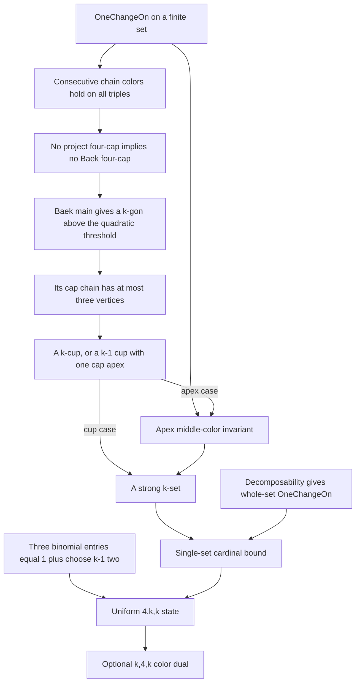

# R21 proof map

The two required results are certified in their original sources. This map
explains their proof, rather than adding a statement or claiming the full
happy-ending conjecture. Receipts, commits and current operations are in
`MATHEMATICAL-HANDOFF.md`.



## Why Baek's threshold is quadratic

The complete port keeps the source's label and lacing argument. Beta is the
longest cup ending at a vertex, minus one. Delta chooses the least vertex in
each beta class below the relevant cutoff. In the n-to-n+1 induction,
`delta (n+2)` removes at most n+2 points. Pascal gives
`choose (n+3) 2 - (n+2) = choose (n+2) 2`, so the complement retains the
preceding induction threshold, including its extra two points.

The complement supplies interweaved laced cups. The label/slope rules and
the removed beta representatives permit an extension when an asymmetric
join is absent; otherwise cup-freeness is contradicted. If both join
orientations exist, the joining theorem supplies the needed lacing directly.
The lacing-to-gon theorem finishes `Baek.main`. These are actual compiled
source arguments, not a formula fitted to numerical evidence.

Entry points in `ESBlueprint/C/CardLeChooseOfOneChangeNoCapFourNoStrong.lean`:
`Config.MainGoal` around line 1465, `delta` around 1959,
`main_induction_wlog` around 2118, `Config.main_lemma` around 2215,
and `Baek.main` around 2257. All ported sections identify their original
Apache-2.0 source file and pinned upstream commit.

## Why the project bridge works

The private chain bridge around line 2275 inducts on the outer index span.
For a nonconsecutive triple, split the span with an adjacent internal vertex.
The first and last triple colors in the resulting quartet agree by the
smaller-span hypotheses. OneChangeOn then makes every color in that quartet
agree, including the desired triple. Sorted lists give order embeddings and
distinct vertices, allowing conversion to the project's all-triple predicates.

Invoke Baek's theorem at n=k-3, for k at least three. If the cardinal bound
fails, the cardinality is at least `choose (k-1) 2 + 2`. A cap list of four
or more vertices would have a four-prefix which the chain bridge promotes
to a forbidden project four-cap. Thus the gon's cap list has length two
or three, while its cup and cap lists share both endpoints.

Length two leaves a k-cup, which is strong. Length three leaves a (k-1)-cup
with extrema p,r and a cap apex q between them. The private apex lemma
around line 2377 proves the precise color rule: a triple in the union turns
right exactly when its middle vertex is q. The endpoint cap and cup colors
propagate through quartets (p,q,y,r), (p,x,q,y), (p,q,x,y), and (x,y,q,r).
The rule immediately gives both strong-polygon equalities. The endpoint
triple has opposite colors if q belongs to the cup, excluding that overlap;
sorted-list distinctness and insertion then give exactly k vertices.

The registered single-set result starts around line 2449. OneChangeOn is
essential to this translation. The fixed diagnostic in `parity-witness/`
exhibits a consecutive-chain gon whose union is not strong when that law
is omitted. That diagnostic is explicitly not Lean-certified theorem credit.

## Why the requested state needs no child-tail induction

`IsDecomposableOn.turnSequenceAllowed` supplies OneChangeOn on the whole set,
so the single-set bound applies directly. For k at least five,

```
T(4,k,k) = choose (k-2) (k-4) + choose (k-2) (k-3) + 1
         = choose (k-2) 2 + (k-2) + 1
         = 1 + choose (k-1) 2.
```

A set larger than this threshold therefore has a four-cap or a strong k-set.
The cup disjunct in `DecomposableStateUpper` is not needed. The exact approved
`hgate` binder remains in the exported declaration and is unused by its proof.
Callers of that exact declaration still provide the gate term; proving or
integrating that term is the coordinator's separately reviewed work.

This proves the uniform four-diagonal slice. A four-cap for large k does not
itself supply a strong k-set, so this slice does not settle the full diagonal
happy-ending conjecture. No new proof idea for the remaining arbitrary-cap
states is claimed. The optional color dual uses the existing symmetry theorem
and has no additional combinatorial argument.
